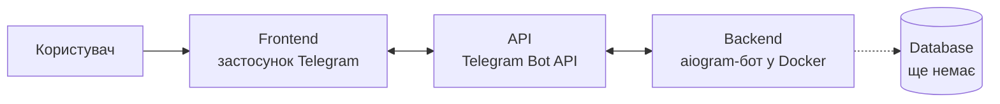
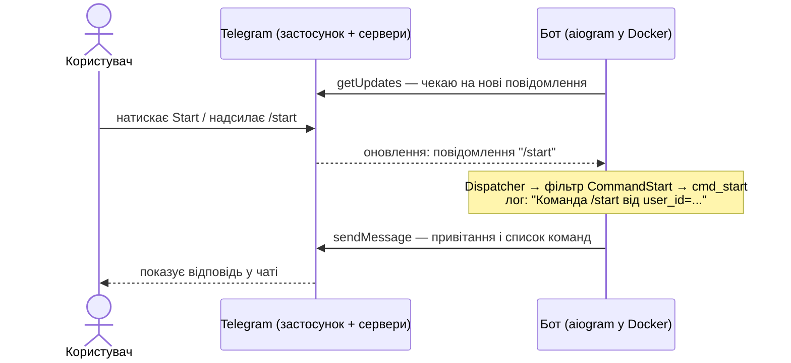

# Архітектура

## Продукт

Telegram-бот для обліку фінансових операцій під час пригону авто з-за кордону, його ремонту та продажу.

Для кожного авто бот має зберігати всі гроші, які пішли на нього і прийшли за нього:

- купівля авто за кордоном;
- доставка;
- розмитнення та оформлення;
- ремонт і запчастини;
- продаж.

Головна мета — бачити, скільки вже вкладено в кожне авто і який прибуток вийшов після продажу.

Зараз реалізовано лише каркас бота: команди `/start` і `/help`, логування, запуск у Docker. Облік операцій — наступні кроки.

## Блоки продукту

| Блок | Що це в нашому проєкті | Стан |
|---|---|---|
| Frontend | застосунок Telegram: чат, команди, кнопки | є (Telegram), власного інтерфейсу немає |
| Backend | бот на Python + aiogram 3 (`app/main.py`), працює в Docker | є, лише `/start` і `/help` |
| Database | сховище авто та фінансових операцій | **немає** |
| API | Telegram Bot API — через нього бот отримує і надсилає повідомлення | є (зовнішній, Telegram); **власного API немає** |

### Frontend

Frontend — це те, що бачить і з чим працює користувач.

У Telegram-боті ми не пишемо власний інтерфейс: його роль виконує застосунок Telegram (на телефоні, ПК або у браузері). Користувач надсилає команди й текст, а бачить відповіді бота.

Що з frontend контролює наш код — це вміст повідомлень, які надсилає бот: текст, а згодом кнопки та меню (inline- і reply-клавіатури aiogram).

**Зараз:** текстові команди `/start` і `/help`, кнопок і меню немає.

**Далі для продукту:** кнопки «Додати авто», «Додати витрату», «Мої авто», «Звіт по авто», щоб не набирати команди вручну.

### Backend

Backend — це логіка: що робити з кожним повідомленням користувача.

У нас це Python-застосунок на aiogram 3 (`app/main.py`), який працює в Docker-контейнері `first-bot`:

- `Dispatcher` отримує оновлення від Telegram і вирішує, який обробник викликати;
- обробники (handlers) — функції `cmd_start`, `cmd_help`, які формують відповідь;
- токен бота береться зі змінної середовища `BOT_TOKEN`;
- кожен старт і кожна команда пишуться в лог.

**Зараз:** лише `/start` і `/help`, бізнес-логіки обліку немає.

**Далі для продукту:** обробники для додавання авто й операцій, підрахунок вкладень і прибутку по кожному авто.

### Database

Database — місце, де дані зберігаються між запусками бота.

**Зараз бази даних немає.** Бот нічого не запам'ятовує: після перезапуску контейнера не лишається жодних даних, крім логів.

Для продукту база обов'язкова — без неї облік неможливий. Мінімальна структура:

| Таблиця | Що зберігає |
|---|---|
| `cars` | авто: марка, модель, рік, VIN, статус (куплено / в дорозі / розмитнено / в ремонті / продано) |
| `operations` | фінансова операція: авто, тип (купівля, доставка, розмитнення, ремонт, продаж), сума, валюта, дата, коментар |

Прибуток по авто = сума продажу − сума всіх витрат на це авто.

Для навчального проєкту достатньо SQLite (один файл, окремий сервер не потрібен). Якщо ботом користуватимуться кілька людей одночасно — PostgreSQL окремим контейнером у `docker-compose.yml`.

### API

API — спосіб, у який програми обмінюються даними.

У проєкті використовується одне API — **Telegram Bot API**. Це зовнішній HTTP API від Telegram: aiogram звертається до нього замість нас.

| Метод Telegram Bot API | Для чого |
|---|---|
| `getMe` | під час старту перевірити токен і дізнатися ім'я бота (саме тут виникає `Unauthorized` при неправильному токені — див. [DEBUG.md](../DEBUG.md)) |
| `getUpdates` | отримувати нові повідомлення (long polling) |
| `sendMessage` | надіслати відповідь користувачу |

Бот працює через **long polling**: він сам постійно питає Telegram «чи є нові повідомлення?». Тому боту не потрібна публічна адреса, відкритий порт чи тунель ngrok.

**Власного API в нас немає** — бот нічого не надає іншим програмам.

**Далі для продукту** можуть знадобитися зовнішні API, наприклад курси валют НБУ — щоб перераховувати витрати в євро, доларах і гривнях в одну валюту.

## Як працює команда `/start`

Покроково:

1. **Frontend.** Користувач відкриває бота в Telegram і натискає **Start** — застосунок надсилає повідомлення `/start` на сервери Telegram.
2. **API.** Бот у циклі викликає `getUpdates` Telegram Bot API і отримує це повідомлення як оновлення (update).
3. **Backend.** `Dispatcher` перевіряє обробники по черзі. Фільтр `CommandStart()` підходить, тому викликається `cmd_start`.
4. **Backend.** `cmd_start` записує в лог `Команда /start від user_id=...` і формує текст: привітання + список команд із `COMMANDS_TEXT`.
5. **API.** `message.answer(...)` — aiogram викликає метод `sendMessage` Telegram Bot API.
6. **Frontend.** Telegram показує користувачу відповідь у чаті.
7. **Database.** Не використовується — бази ще немає, і для `/start` вона не потрібна.

### Як це зміниться з базою даних

Майбутня команда, наприклад «Додати витрату», пройде через усі чотири блоки:

1. **Frontend** — користувач обирає авто й вводить «Ремонт, 450 EUR».
2. **API** — повідомлення приходить через `getUpdates`.
3. **Backend** — обробник розбирає суму, валюту й тип операції.
4. **Database** — операція записується в таблицю `operations`, рахується нова сума вкладень по авто.
5. **API** → **Frontend** — бот відповідає: «Додано. Усього вкладено в авто: 6 230 EUR».

## Ті самі блоки в реальних застосунках

Три функції із застосунків, якими я користуюся. Внутрішня будова цих сервісів не публічна, тому frontend, API, backend і database описано в загальних рисах — так, як зазвичай влаштовані подібні функції.

### 1. Перегляд балансу

**Застосунок:** Приват24 (ПриватБанк).

**Функція:** перегляд балансу картки.

**Що робить користувач:** відкриває застосунок, входить за PIN-кодом або відбитком пальця і бачить список карток із залишком на кожній.

**Frontend:** мобільний застосунок Приват24 — екран входу, список карток, сума залишку. Показує дані, але сам їх не рахує.

**API:** застосунок надсилає на сервер банку захищений запит (HTTPS) «дай баланс моїх карток» разом із токеном сесії, який підтверджує, що це саме цей користувач після входу.

**Backend:** сервери банку перевіряють сесію і права доступу, знаходять картки клієнта, отримують залишок із банківської системи обліку рахунків і повертають його застосунку.

**Database:** база клієнтів і рахунків банку: хто власник картки, які рахунки до неї прив'язані, поточний залишок і всі операції, з яких він складається.

**Який результат отримує користувач:** актуальний залишок на кожній картці за кілька секунд — без дзвінка в банк чи банкомата.

**Що схоже на наш продукт:** «скільки вкладено в авто» — це той самий «баланс», тільки порахований із наших операцій у таблиці `operations`.

### 2. Прокладання маршруту

**Застосунок:** Waze.

**Функція:** прокладання маршруту до адреси з урахуванням заторів.

**Що робить користувач:** вводить адресу або обирає місце на карті й натискає «Поїхали».

**Frontend:** мобільний застосунок — карта, поле пошуку, лінія маршруту, час у дорозі, голосові підказки. Також постійно передає GPS-позицію телефону.

**API:** застосунок надсилає на сервер точку старту (GPS), точку призначення та налаштування (наприклад, «уникати платних доріг») і отримує у відповідь маршрут. Під час руху продовжує надсилати свою позицію та швидкість.

**Backend:** сервери Waze шукають адресу, будують кілька варіантів маршруту по графу доріг і оцінюють час для кожного з урахуванням поточних заторів. Затори рахуються з GPS-даних інших водіїв у реальному часі та їхніх повідомлень про ДТП, ремонти, поліцію.

**Database:** карта доріг (вулиці, напрямки руху, обмеження швидкості), адреси й місця, історична та поточна швидкість руху на кожній ділянці, повідомлення водіїв.

**Який результат отримує користувач:** найшвидший маршрут на цей момент, очікуваний час прибуття та покрокові підказки; якщо попереду з'являється затор — пропозиція об'їзду.

**Що схоже на наш продукт:** Waze поєднує дані від багатьох користувачів; так само наш бот може рахувати підсумки по всіх авто, а не лише по одному.

### 3. Перегляд відео

**Застосунок:** YouTube.

**Функція:** перегляд відео.

**Що робить користувач:** відкриває застосунок або сайт, обирає відео з рекомендацій чи пошуку й натискає на нього.

**Frontend:** застосунок або сторінка в браузері — стрічка рекомендацій, плеєр, кнопки «подобається», підписка, коментарі.

**API:** застосунок запитує в сервера інформацію про відео (назва, автор, лайки, коментарі) і посилання на відеопотік. Саме відео завантажується невеликими частинами з найближчого сервера мережі доставки контенту (CDN) — у якості, яку дозволяє швидкість інтернету.

**Backend:** сервери YouTube перевіряють доступність відео (регіон, вікові обмеження), обирають найближчий сервер із копією відео, рахують перегляди та формують рекомендації, що дивитися далі.

**Database:** інформація про відео, канали, коментарі, підписки та історію переглядів користувача. Самі відеофайли — у кількох якостях — зберігаються окремо, у файловому сховищі, з копіями по всьому світу.

**Який результат отримує користувач:** відео починає грати за секунди без довгого завантаження, якість підлаштовується під інтернет, а поруч — рекомендації наступних відео.

**Що схоже на наш продукт:** YouTube зберігає великі файли окремо від бази даних; так само ми згодом можемо зберігати фото чеків і документів на авто у файловому сховищі, а в базі — лише посилання на них.
