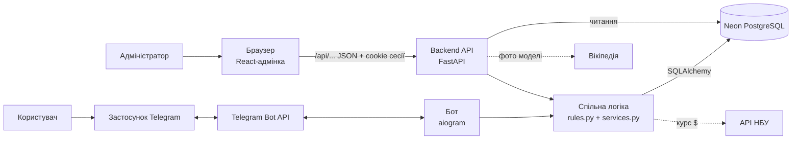
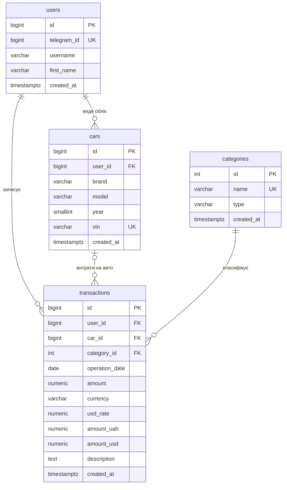
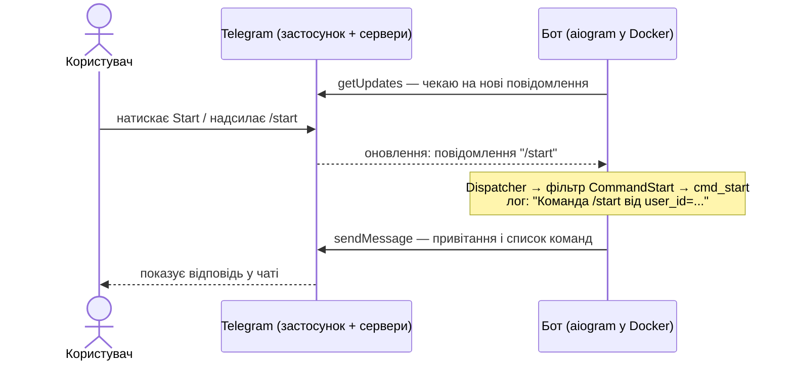
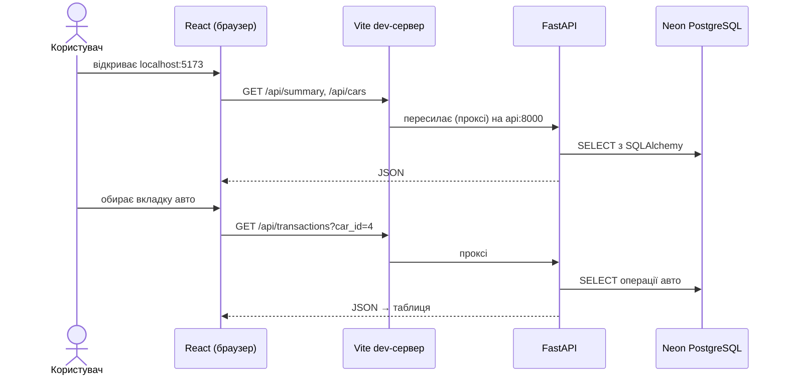
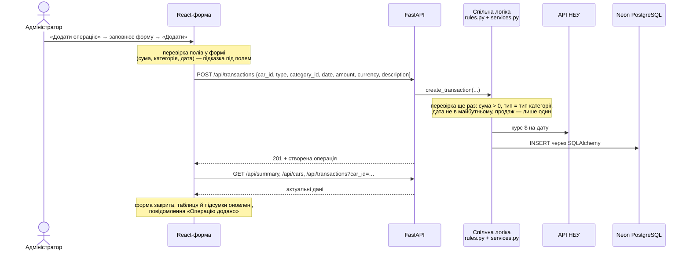
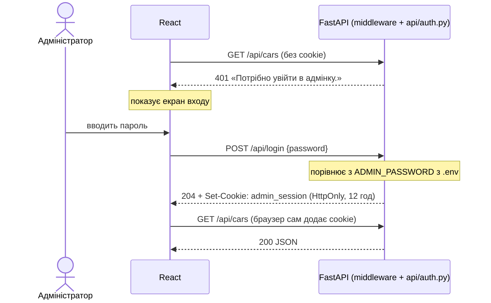

# Архітектура

## Продукт

Облік фінансових операцій під час пригону авто з-за кордону, його ремонту та продажу. Два інтерфейси — Telegram-бот і web-адмінка — працюють з однією базою і однаковими правилами: в обох можна додати, змінити й видалити авто та операції.

Для кожного авто зберігаються всі гроші, які пішли на нього і прийшли за нього:

- купівля авто за кордоном;
- доставка;
- розмитнення та оформлення;
- ремонт і запчастини;
- продаж.

Головна мета — бачити, скільки вже вкладено в кожне авто і який прибуток вийшов після продажу.

**Що вже працює:**

- бот: авто, витрати й продаж з датою й валютою (грн або $), курс НБУ на дату операції, картки авто з прибутком; зміна й видалення авто та операцій;
- web-адмінка (вхід за паролем): вкладка на кожне авто з витратами, доходом, прибутком і таблицею операцій, загальні підсумки; додати, змінити й видалити авто та операції, фільтри «Усі / Доходи / Витрати»;
- спільна логіка перевірок і змін (`app/rules.py`, `app/services.py`) — однакові правила в боті й адмінці.

**Що далі:** повноцінна авторизація з окремими користувачами (вхід через Telegram), фото авто з бота, деплой на Render, LLM-аналіз.

## Блоки продукту

У продукті тепер два інтерфейси з однією базою.

| Блок | Що це в нашому проєкті | Стан |
|---|---|---|
| Frontend | 1) застосунок Telegram — чат і кнопки бота; 2) web-адмінка на React + Vite (`frontend/`) | є, адмінка — перегляд і керування, вхід за паролем |
| Backend | 1) бот на aiogram 3 (`app/`); 2) backend API на FastAPI (`api/`). Обидва в Docker, спільні моделі, підключення до бази й **спільна логіка змін** (`app/services.py`) | є |
| Database | Neon PostgreSQL: користувачі, авто, категорії, операції; структура змінюється міграціями Alembic | є — схема в [database.md](database.md) |
| API | 1) Telegram Bot API (зовнішній); 2) **власний API** для адмінки (`/api/...`); 3) зовнішні: курс НБУ, Вікіпедія | є |



### Frontend

Frontend — це те, що бачить і з чим працює користувач. У продукті їх два.

**1. Telegram-бот.** Власний інтерфейс не пишемо: його роль виконує застосунок Telegram. Наш код задає вміст повідомлень і кнопки:

- **головне меню** (reply-клавіатура): «🚗 Додати авто», «📋 Мої авто», «💸 Додати витрату», «💰 Продаж авто», «❓ Допомога»;
- **кнопки в повідомленнях** (inline-клавіатура) з іконками — авто, категорія, дата (Сьогодні / Вчора / Інша), валюта (₴ / $);
- **керування з «📋 Мої авто»** — авто → «📄 Операції» (по 10, гортання) → операція → «✏️ Змінити» / «🗑 Видалити»; «✏️ Змінити авто», «🗑 Видалити авто». Кнопки несуть номер авто чи операції (aiogram `CallbackData`), тому працюють і в старих повідомленнях;
- **кнопка «Меню»** — команди `/addcar`, `/cars`, `/expense`, `/sell`, `/cancel`, `/help`.

**2. Web-адмінка** (`frontend/`, React + Vite) — сторінка в браузері з входом за паролем: вкладки авто, картки витрат, доходу й прибутку, таблиця операцій з фільтрами, загальні підсумки в шапці; форми додавання й зміни авто та операцій у вікнах поверх сторінки, підтвердження перед видаленням. Темна тема з неоновим підсвіченням, власні SVG-іконки. Дані бере й змінює тільки через backend API — див. [Web-адмінка](#web-адмінка).

### Backend

Backend — це логіка: що робити із запитом користувача. У продукті два backend-и з однією базою й спільними моделями. Усе працює в Docker:

| Сервіс (`docker-compose.yml`) | Що робить |
|---|---|
| `migrate` | оновлює структуру бази (`alembic upgrade head`) і завершується; `bot` і `api` стартують лише після нього |
| `bot` (контейнер `first-bot`) | Telegram-бот на aiogram 3 |
| `api` (контейнер `admin-api`) | backend API для адмінки на FastAPI, `localhost:8000` |
| `frontend` (контейнер `admin-frontend`) | dev-сервер React-адмінки, `localhost:5173` |

| Файл | Що робить |
|---|---|
| `app/main.py` | бот: обробники команд і кнопок, кроки діалогу (FSM), меню, зміна й видалення |
| `app/rules.py` | правила перевірки даних без бази: сума, дата, валюта, тип, опис, авто |
| `app/services.py` | дії зі змінами: створити / змінити / видалити авто чи операцію — перевірка, правила обліку, курс НБУ, запис |
| `app/errors.py` | помилки з текстом для людини: `ValidationError`, `NotFoundError`, `ConflictError`, `RateUnavailableError` |
| `app/crud.py` | запити до бази: користувач, авто, категорії, операції, калькуляція авто (`car_summary`) |
| `app/models.py` | таблиці бази як класи SQLAlchemy — спільні для бота, API й міграцій |
| `app/db.py` | підключення до Neon, перевірка версії схеми під час старту |
| `app/nbu.py` | офіційний курс $ НБУ на дату (з кешем) і перерахунок грн ↔ $ |
| `api/main.py` | FastAPI: читання й зміна авто та операцій, помилки → JSON, перевірка сесії для кожного `/api/...` |
| `api/auth.py` | вхід за паролем `ADMIN_PASSWORD`: сесія в cookie, підпис, блокування підбору |
| `api/car_images.py` | пошук фото моделі у Вікіпедії (з кешем) |
| `migrations/versions/` | міграції Alembic: `0001` — початкова схема, `0002` — доходи, валюта, дата, курс |

Бот:

- `Dispatcher` вирішує, який обробник викликати; **FSM** пам'ятає крок: авто → категорія → дата → валюта → сума;
- розбирає текст користувача (`450 заміна фар`, `25.11.2026`, `BMW X5 2018`), а перевіряє й записує через спільну логіку: рік і VIN, дата не в майбутньому, сума більша за 0, авто належить цьому користувачу, авто не продане двічі (рядок авто блокується на час запису);
- якщо курс НБУ недоступний — операцію не записує, щоб не зберегти неправильну суму;
- кожен користувач бачить і змінює лише свої авто й операції (`owner_id` у спільній логіці);
- пише в лог старт, команди й номери записів, без сум і секретів.

API:

- читає базу й змінює її через ту саму спільну логіку, що й бот; повертає JSON; помилки — JSON з текстом українською (`401`, `404`, `409`, `422`, `503`);
- без входу паролем відповідає `401` на все, крім `/api/health`;
- отримує тільки `DATABASE_URL` і `ADMIN_PASSWORD`, без `BOT_TOKEN`; доступний лише з цього ПК (`127.0.0.1:8000`).

### Спільна логіка: однакові правила в боті й адмінці

Будь-яка зміна — з бота чи з адмінки — проходить однаковий шлях:

```
перевірка даних (app/rules.py)
  → правила обліку (app/services.py): продаж лише один, тип операції не змінюється,
    продаж — лише на непродане авто, власник існує
  → курс НБУ на дату операції (нова дата — новий курс)
  → запис через SQLAlchemy (app/crud.py) у Neon
```

Помилки (`app/errors.py`) мають текст для людини: бот показує його в чаті, API — у полі `detail` JSON-відповіді, React — під формою. Так правило, написане один раз, діє в обох інтерфейсах і не може розійтися.

### Database

Database — місце, де дані зберігаються між запусками бота.

Для продукту база обов'язкова — без неї облік неможливий.

**Що обрано:** [Neon](https://neon.tech) — PostgreSQL у хмарі. Python-код працює з нею через **SQLAlchemy**, структуру бази змінюють міграції **Alembic**. Маршрути:

```
запис:   Telegram → Telegram Bot API → aiogram backend → SQLAlchemy → Neon PostgreSQL
читання: Browser → React → FastAPI → SQLAlchemy → Neon PostgreSQL
```

**Схема** — чотири таблиці, повний опис у [database.md](database.md):

| Таблиця | Що зберігає |
|---|---|
| `users` | користувачі Telegram: `telegram_id`, username, ім'я |
| `cars` | авто користувача: марка, модель, рік, VIN |
| `categories` | довідник категорій із типом: 6 категорій витрат і «Продаж авто» (дохід) |
| `transactions` | операції: користувач, авто, категорія, дата операції, сума й валюта введення, курс НБУ, суми в грн і $, опис |



`database.md` — це схема та документація, а не сама база. Щоб побачити діаграму, скопіюйте блок коду з файлу на [dbdiagram.io](https://dbdiagram.io/d).

**Чому так:**

- `users.id` — власний ідентифікатор, а `telegram_id` — окреме унікальне поле. Так база не залежить від Telegram, якщо колись з'явиться інший вхід (наприклад, вебсторінка).
- `categories` — окрема таблиця, а не текст в операції: назви не дублюються і не розходяться («ремонт», «Ремонт», «ремонт авто»), а звіт по категорії — простий запит.
- `amount` — `numeric(12, 2)`, а не `float`: гроші треба рахувати точно, до копійки.
- Індекс `(user_id, created_at)` — щоб швидко показувати операції користувача за датою.
- `cars.user_id` — у кожного користувача свій список авто.
- `transactions.car_id` у базі необов'язковий — щоб у майбутньому можна було записати загальну витрату, не прив'язану до авто. Бот зараз завжди просить спершу обрати авто. Сума всіх операцій з одним `car_id` — це скільки вкладено в це авто.
- `cars.vin` унікальний, але може бути порожнім — VIN не завжди відомий одразу.
- `categories.type` (`expense` / `income`) — дохід і витрата розрізняються категорією; продаж авто — операція в категорії доходу «Продаж авто». Авто продане, якщо в нього є така операція; одне авто — лише один продаж.
- `operation_date` окремо від `created_at`: витрату можна записати «заднім числом».
- Курс НБУ і суми в обох валютах **зберігаються разом з операцією**: старі суми не перераховуються, коли курс змінюється. Прибуток у $ — різниця сум у $ на дати операцій.
- Зміни структури — лише через міграції Alembic: кожна зміна — файл у Git, на новій базі (наприклад, на Render) схема створюється однією командою.

**Що відкладено на наступні версії:**

- фото авто, надіслане в бота, замість фото моделі з Вікіпедії;
- інші валюти (EUR).

### API

API — спосіб, у який програми обмінюються даними. У проєкті їх кілька.

**1. Telegram Bot API** — зовнішній HTTP API від Telegram: aiogram звертається до нього замість нас.

| Метод Telegram Bot API | Для чого |
|---|---|
| `getMe` | під час старту перевірити токен і дізнатися ім'я бота (саме тут виникає `Unauthorized` при неправильному токені — див. [DEBUG.md](../DEBUG.md)) |
| `getUpdates` | отримувати нові повідомлення (long polling) |
| `sendMessage` | надіслати відповідь користувачу |

Бот працює через **long polling**: він сам постійно питає Telegram «чи є нові повідомлення?». Тому боту не потрібна публічна адреса, відкритий порт чи тунель ngrok.

**2. Власний API для адмінки** (`api/main.py`, FastAPI) — React отримує й змінює дані тільки через нього:

| Endpoint | Що робить |
|---|---|
| `GET /api/transactions` | операції (параметри `limit`, `car_id`) |
| `POST /api/transactions` · `PUT /api/transactions/{id}` · `DELETE /api/transactions/{id}` | створити · змінити · видалити операцію |
| `GET /api/summary` | `total_income`, `total_expense`, `balance` у грн і $ |
| `GET /api/cars` | авто з власником, калькуляцією й фото моделі |
| `POST /api/cars` · `PUT /api/cars/{id}` · `DELETE /api/cars/{id}` | додати · змінити · видалити авто (разом з операціями) |
| `GET /api/categories` · `GET /api/users` | категорії й власники — для форм |
| `POST /api/login` · `POST /api/logout` | вхід за паролем і вихід |
| `GET /api/health` | чи працює API і чи доступна база (без входу) |

Документація й перевірка в браузері — http://localhost:8000/docs (FastAPI генерує її сам).

**3. Зовнішні API, якими користується backend:**

| API | Хто звертається | Що передаємо | Навіщо |
|---|---|---|---|
| НБУ `bank.gov.ua/NBUStatService` | бот, міграція `0002` | лише дату | офіційний курс $ на дату операції |
| Вікіпедія `en.wikipedia.org/w/api.php` | backend API | лише марку й модель | фото моделі для вкладки авто |

Обидва відкриті й безкоштовні, без ключів. Дані користувачів туди не передаються.

## Як працює команда `/start`



Покроково:

1. **Frontend.** Користувач відкриває бота в Telegram і натискає **Start** — застосунок надсилає повідомлення `/start` на сервери Telegram.
2. **API.** Бот у циклі викликає `getUpdates` Telegram Bot API і отримує це повідомлення як оновлення (update).
3. **Backend.** `Dispatcher` перевіряє обробники по черзі. Фільтр `CommandStart()` підходить, тому викликається `cmd_start`.
4. **Backend.** `cmd_start` записує в лог `Команда /start від user_id=...` і формує текст: привітання + список команд із `COMMANDS_TEXT`.
5. **API.** `message.answer(...)` — aiogram викликає метод `sendMessage` Telegram Bot API.
6. **Frontend.** Telegram показує користувачу відповідь у чаті.
7. **Database.** Не використовується — для привітання база не потрібна.

Разом із привітанням бот надсилає кнопки головного меню (reply-клавіатуру).

## Як працює запис витрати

«💸 Додати витрату» проходить через усі чотири блоки, включно з базою:

```mermaid
sequenceDiagram
    actor U as Користувач
    participant TG as Telegram
    participant BOT as Бот (aiogram)
    participant DB as Neon PostgreSQL

    participant NBU as API НБУ

    U->>TG: натискає «💸 Додати витрату»
    TG-->>BOT: getUpdates: текст кнопки
    BOT->>DB: знайти / створити користувача, його авто
    BOT->>TG: кнопки з авто
    U->>TG: авто → категорія → дата → валюта
    TG-->>BOT: callback_query "op_car:<id>", "op_cat:<id>", "op_date:today", "op_cur:UAH"
    BOT->>DB: перевірити, що авто належить користувачу; категорії витрат
    U->>TG: пише «450 заміна фар»
    BOT->>NBU: курс $ на дату операції
    Note over BOT: суми в грн і $ за цим курсом
    BOT->>DB: INSERT у transactions, підсумок по авто
    BOT->>TG: «✅ Витрату записано… Підсумок по авто»
    TG-->>U: показує відповідь
```

1. **Frontend.** Користувач натискає кнопку меню «💸 Додати витрату».
2. **Backend → Database.** Бот знаходить користувача за `telegram_id` (або створює запис у `users`) і читає його авто з `cars`. Якщо авто немає — пропонує спершу додати авто.
3. **Frontend.** Користувач кнопками обирає авто, категорію, дату й валюту — над кожним кроком бот показує, що вже обрано.
4. **Backend → Database.** Бот перевіряє, що авто належить саме цьому користувачу, і показує лише категорії витрат.
5. **Frontend.** Користувач пише суму з описом: `450 заміна фар`.
6. **Backend → API НБУ.** Бот перевіряє суму і бере офіційний курс $ на дату операції. Якщо НБУ недоступний — операцію не записує.
7. **Database.** Новий рядок у `transactions`: дата, сума й валюта введення, курс, суми в грн і $, опис. Бот рахує підсумок по авто.
8. **API → Frontend.** Бот відповідає: «✅ Витрату записано» з сумою в обох валютах, курсом і підсумком по авто.

Продаж авто («💰 Продаж авто») іде тим самим шляхом без кроку категорії: бот сам бере категорію «Продаж авто» і перевіряє, що авто ще не продане.

Поки користувач проходить кроки, бот пам'ятає вибір у FSM (у пам'яті процесу). Якщо бот перезапуститься посередині, незавершений запис губиться — треба почати заново.

## Web-адмінка

Від Telegram-бота до SaaS: спершу адмінка лише показувала дані (схема нижче), потім навчилася ними керувати — див. [Керування даними](#керування-даними-react-форма--api--neon) і [Вхід в адмінку](#вхід-в-адмінку).



**Важливе правило:** React не підключається до Neon напряму. Frontend звертається тільки до backend API. Саме backend читає `DATABASE_URL` із `.env`, працює з базою і повертає React лише потрібні дані в JSON. `DATABASE_URL` ніколи не потрапляє у frontend.

Як це влаштовано:

- React (`frontend/src/api.js`) робить запити на відносну адресу `/api/...` — ту саму, звідки завантажена сторінка;
- dev-сервер Vite (`frontend/vite.config.js`) пересилає їх на backend (`API_URL`, у Docker — `http://api:8000`). Тому браузер не знає адреси бази, а CORS не потрібен;
- на хостингу (Render) адресу API можна буде задати змінною `VITE_API_BASE_URL`.

Сторінка:

| Частина | Дані |
|---|---|
| шапка: доходи, витрати, баланс по всіх авто (у $) | `GET /api/summary` |
| вкладки авто: фото, статус, власник, картки «Витрати», «Дохід», «Прибуток» | `GET /api/cars` |
| таблиця операцій обраного авто, фільтри | `GET /api/transactions?car_id=…` |
| форми: категорії за типом, власники авто | `GET /api/categories`, `GET /api/users` |

Стани: «Завантаження…» під час запиту; якщо API недоступний — зрозуміла помилка з підказками, що перевірити, і кнопка «Спробувати ще раз». Обрана вкладка зберігається в адресі (`#car-4`).

Суми показуються до цілого числа, курс — з 2 знаками (як у боті); API віддає точні значення, округлює React.

### Керування даними: React-форма → API → Neon



1. **Frontend просить виконати дію** — `POST` / `PUT` / `DELETE`. React не записує дані в Neon напряму.
2. **Backend перевіряє дані.** Перевірка у формі React — лише зручна підказка; справжня — на backend, тому запит в обхід форми (наприклад, через `/docs`) отримає ту саму помилку.
3. **Database зберігає зміни** — через SQLAlchemy у Neon.
4. **React показує актуальний результат** — заново завантажує таблицю, картки авто й підсумки.

Якщо backend не прийняв дані — відповідає JSON з поясненням (`422` «Сума має бути більшою за 0.», `409` «Це авто вже продано…»), форма лишається заповненою, пояснення показується внизу форми.

Видалення: React спершу показує вікно «Видалити операцію?» з даними операції (для продажу — окреме попередження, що авто стане непроданим) і лише після підтвердження надсилає `DELETE`. Фільтри «Усі / Доходи / Витрати» працюють у React і лише змінюють, що видно в таблиці.

### Вхід в адмінку



- Пароль — лише в `.env` і змінній середовища контейнера `api`; у браузері не зберігається.
- Middleware перевіряє сесію на кожному `/api/...`, крім `/api/health`, `/api/login`, `/api/logout` — нові endpoint-и закриті автоматично.
- Якщо сесія закінчилась, будь-який запит отримує `401`, і React знову показує екран входу.
- Це базовий навчальний захист (один спільний пароль), тому адмінка лишається тільки на `127.0.0.1` — деталі й межі в [security.md](security.md#пароль-адмінки-admin_password).

## Ті самі блоки в реальних застосунках

Три функції із застосунків, якими я користуюся. Внутрішня будова цих сервісів не публічна, тому frontend, API, backend і database описано в загальних рисах — так, як зазвичай влаштовані подібні функції.

### 1. Перегляд балансу

**Застосунок:** Приват24 (ПриватБанк).

**Функція:** перегляд балансу картки.

**Що робить користувач:** відкриває застосунок, входить за PIN-кодом або відбитком пальця і бачить список карток із залишком на кожній.

**Frontend:** мобільний застосунок Приват24 — екран входу, список карток, сума залишку. Показує дані, але сам їх не рахує.

**API:** застосунок надсилає на сервер банку захищений запит (HTTPS) «дай баланс моїх карток» разом із токеном сесії, який підтверджує, що це саме цей користувач після входу.

**Backend:** сервери банку перевіряють сесію і права доступу, знаходять картки клієнта, отримують залишок із банківської системи обліку рахунків і повертають його застосунку.

**Database:** база клієнтів і рахунків банку: хто власник картки, які рахунки до неї прив'язані, поточний залишок і всі операції, з яких він складається.

**Який результат отримує користувач:** актуальний залишок на кожній картці за кілька секунд — без дзвінка в банк чи банкомата.

**Що схоже на наш продукт:** «скільки вкладено в авто» — це той самий «баланс», тільки порахований із наших операцій у таблиці `transactions`.

### 2. Прокладання маршруту

**Застосунок:** Waze.

**Функція:** прокладання маршруту до адреси з урахуванням заторів.

**Що робить користувач:** вводить адресу або обирає місце на карті й натискає «Поїхали».

**Frontend:** мобільний застосунок — карта, поле пошуку, лінія маршруту, час у дорозі, голосові підказки. Також постійно передає GPS-позицію телефону.

**API:** застосунок надсилає на сервер точку старту (GPS), точку призначення та налаштування (наприклад, «уникати платних доріг») і отримує у відповідь маршрут. Під час руху продовжує надсилати свою позицію та швидкість.

**Backend:** сервери Waze шукають адресу, будують кілька варіантів маршруту по графу доріг і оцінюють час для кожного з урахуванням поточних заторів. Затори рахуються з GPS-даних інших водіїв у реальному часі та їхніх повідомлень про ДТП, ремонти, поліцію.

**Database:** карта доріг (вулиці, напрямки руху, обмеження швидкості), адреси й місця, історична та поточна швидкість руху на кожній ділянці, повідомлення водіїв.

**Який результат отримує користувач:** найшвидший маршрут на цей момент, очікуваний час прибуття та покрокові підказки; якщо попереду з'являється затор — пропозиція об'їзду.

**Що схоже на наш продукт:** Waze поєднує дані від багатьох користувачів; так само наш бот може рахувати підсумки по всіх авто, а не лише по одному.

### 3. Перегляд відео

**Застосунок:** YouTube.

**Функція:** перегляд відео.

**Що робить користувач:** відкриває застосунок або сайт, обирає відео з рекомендацій чи пошуку й натискає на нього.

**Frontend:** застосунок або сторінка в браузері — стрічка рекомендацій, плеєр, кнопки «подобається», підписка, коментарі.

**API:** застосунок запитує в сервера інформацію про відео (назва, автор, лайки, коментарі) і посилання на відеопотік. Саме відео завантажується невеликими частинами з найближчого сервера мережі доставки контенту (CDN) — у якості, яку дозволяє швидкість інтернету.

**Backend:** сервери YouTube перевіряють доступність відео (регіон, вікові обмеження), обирають найближчий сервер із копією відео, рахують перегляди та формують рекомендації, що дивитися далі.

**Database:** інформація про відео, канали, коментарі, підписки та історію переглядів користувача. Самі відеофайли — у кількох якостях — зберігаються окремо, у файловому сховищі, з копіями по всьому світу.

**Який результат отримує користувач:** відео починає грати за секунди без довгого завантаження, якість підлаштовується під інтернет, а поруч — рекомендації наступних відео.

**Що схоже на наш продукт:** YouTube зберігає великі файли окремо від бази даних; так само ми згодом можемо зберігати фото чеків і документів на авто у файловому сховищі, а в базі — лише посилання на них.
