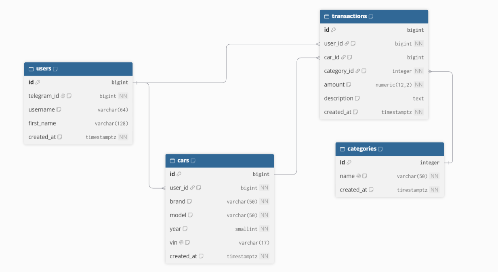

# Схема бази даних

База даних Telegram-бота для обліку витрат на пригін, ремонт і продаж авто.

- **Де:** [Neon](https://neon.tech) — PostgreSQL у хмарі.
- **Як бот із нею працює:** через SQLAlchemy — моделі в [app/models.py](../app/models.py), підключення в [app/db.py](../app/db.py). Таблиці й стандартні категорії бот створює сам під час старту, якщо їх ще немає.
- **Чому схема саме така** — розділ Database в [architecture.md](architecture.md#database).

Цей файл — схема та документація бази, а не сама база.

## Діаграма



## Таблиці

Перша версія — чотири таблиці. В усіх є:

- `id` — унікальний номер запису, база призначає його сама;
- `created_at` — дата й час створення запису з часовим поясом, база ставить його сама.

### users — користувачі Telegram

Хто користується ботом. Запис з'являтиметься автоматично, коли користувач уперше запише операцію (команда запису витрат — наступний крок).

| Поле | Тип | Обов'язкове | Опис |
|---|---|---|---|
| `id` | bigint | так | номер користувача в нашій базі |
| `telegram_id` | bigint | так, **унікальне** | id користувача в Telegram (`message.from_user.id`) |
| `username` | varchar(64) | ні | `@username` — є не в усіх |
| `first_name` | varchar(128) | ні | ім'я з профілю Telegram |
| `created_at` | timestamptz | так | коли користувач з'явився в базі |

`id` і `telegram_id` — різні поля: так база не залежить від Telegram, якщо колись з'явиться інший спосіб входу.

### cars — авто

Авто, які користувач пригнав, ремонтує або продає.

| Поле | Тип | Обов'язкове | Опис |
|---|---|---|---|
| `id` | bigint | так | номер авто |
| `user_id` | bigint | так | → `users.id`, хто веде облік цього авто |
| `brand` | varchar(50) | так | марка, напр. BMW |
| `model` | varchar(50) | так | модель, напр. X5 |
| `year` | smallint | так | рік випуску |
| `vin` | varchar(17) | ні, **унікальне** | VIN-код; може бути ще невідомий, але два авто з однаковим VIN бути не можуть |
| `created_at` | timestamptz | так | коли авто додали |

### categories — категорії витрат

Довідник, спільний для всіх користувачів. Бот заповнює його сам під час старту:

1. Купівля авто
2. Доставка
3. Розмитнення
4. Ремонт
5. Запчастини
6. Інше

| Поле | Тип | Обов'язкове | Опис |
|---|---|---|---|
| `id` | integer | так | номер категорії |
| `name` | varchar(50) | так, **унікальне** | назва категорії |
| `created_at` | timestamptz | так | коли категорію додали |

Категорії — окрема таблиця, а не текст в операції: так не буде різнобою («ремонт», «Ремонт», «ремонт авто»), а суму по категорії легко порахувати.

### transactions — фінансові операції

Кожна витрата, яку записав користувач.

| Поле | Тип | Обов'язкове | Опис |
|---|---|---|---|
| `id` | bigint | так | номер операції |
| `user_id` | bigint | так | → `users.id`, хто записав |
| `car_id` | bigint | ні | → `cars.id`, до якого авто належить; порожнє — загальна витрата |
| `category_id` | integer | так | → `categories.id`, категорія |
| `amount` | numeric(12, 2) | так | сума, **завжди більше 0** (база сама не дасть записати 0 чи мінус) |
| `description` | text | ні | опис від користувача, напр. «заміна фар» |
| `created_at` | timestamptz | так | коли операцію записали |

`amount` — `numeric`, а не `float`: гроші рахуються точно, до копійки. Індекс `(user_id, created_at)` прискорює показ операцій користувача за датою.

## Зв'язки між таблицями

| Зв'язок | Тип | Що означає |
|---|---|---|
| `users` → `cars` | один до багатьох | один користувач веде облік багатьох авто; кожне авто має одного власника запису |
| `users` → `transactions` | один до багатьох | один користувач записує багато операцій; кожна операція — рівно одного користувача |
| `cars` → `transactions` | один до багатьох, **необов'язковий** | на одне авто — багато витрат; операція може бути й без авто |
| `categories` → `transactions` | один до багатьох | в одній категорії багато операцій; кожна операція — рівно в одній категорії |

Зв'язки зроблені через зовнішні ключі (`FOREIGN KEY`): база не дасть записати операцію з неіснуючим користувачем, авто чи категорією.

**Приклад:** скільки вкладено в авто — це сума `amount` усіх операцій з його `car_id`.

## Схема в коді (DBML)

Код для [dbdiagram.io](https://dbdiagram.io/d), з якого зроблено діаграму вище. Копіюйте **тільки вміст блоку** — без рядків із ` ``` `, інакше dbdiagram покаже помилку `Expect an identifier`.

```dbml
Project car_finance_bot {
  database_type: 'PostgreSQL'
  Note: 'Telegram-бот: облік фінансових операцій під час пригону, ремонту та продажу авто'
}

Table users {
  id bigint [pk, increment]
  telegram_id bigint [not null, unique, note: 'id користувача в Telegram (message.from_user.id)']
  username varchar(64) [note: '@username, може бути відсутній']
  first_name varchar(128)
  created_at timestamptz [not null, default: `now()`]

  Note: 'Користувачі Telegram, які надсилали боту операції'
}

Table cars {
  id bigint [pk, increment]
  user_id bigint [not null, ref: > users.id, note: 'власник запису — хто веде облік цього авто']
  brand varchar(50) [not null, note: 'марка, напр. BMW']
  model varchar(50) [not null, note: 'модель, напр. X5']
  year smallint [not null, note: 'рік випуску']
  vin varchar(17) [unique, note: 'VIN-код, 17 символів; може бути ще невідомий']
  created_at timestamptz [not null, default: `now()`]

  Note: 'Авто, які користувач пригнав, ремонтує або продає'
}

Table categories {
  id integer [pk, increment]
  name varchar(50) [not null, unique, note: 'Купівля авто, Доставка, Розмитнення, Ремонт, Запчастини, Інше']
  created_at timestamptz [not null, default: `now()`]

  Note: 'Довідник категорій витрат, спільний для всіх користувачів'
}

Table transactions {
  id bigint [pk, increment]
  user_id bigint [not null, ref: > users.id, note: 'хто записав операцію']
  car_id bigint [ref: > cars.id, note: 'до якого авто належить; порожнє — загальна витрата']
  category_id integer [not null, ref: > categories.id, note: 'до якої категорії належить']
  amount numeric(12, 2) [not null, note: 'сума, завжди > 0']
  description text [note: 'опис від користувача, напр. "заміна фар"']
  created_at timestamptz [not null, default: `now()`]

  indexes {
    (user_id, created_at) [name: 'ix_transactions_user_created']
  }

  Note: 'Фінансові операції користувачів'
}
```
