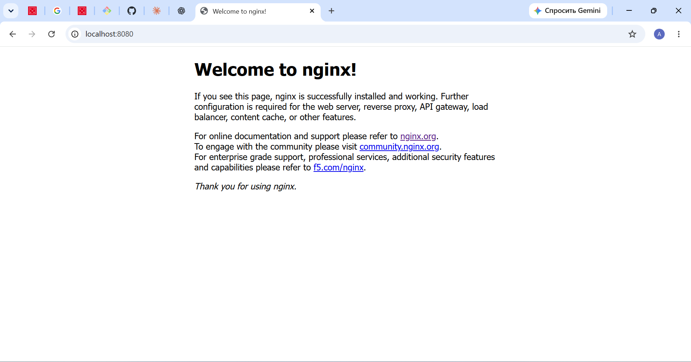

# Environment check

Перевірка середовища розробки на ПК (Windows 11 Pro), 2026-11-10.

## 1. Docker

**Команди:**

```powershell
docker --version
docker info --format "{{.ServerVersion}}"
```

**Результат:**

- Docker Desktop встановлений, версія Docker 29.9.2.
- Під час першої перевірки Docker Desktop не був запущений: команда `docker` не могла під'єднатися до Docker.
- Після запуску Docker Desktop Docker відповідає: версія сервера 29.9.2.

## 2. WSL 2

**Команди:**

```powershell
wsl --status
wsl --version
wsl -l -v
```

**Результат:**

- WSL встановлений, версія 3.0.3.0, ядро 6.18.54.1.
- Версія WSL за замовчуванням: 2.
- Дистрибутиви: тільки `docker-desktop`, він працює у режимі WSL 2 (`Running`).
- Окремого Linux-дистрибутива (наприклад, Ubuntu) не встановлено. Для роботи Docker він не потрібен.

## 3. Тестовий контейнер nginx

**Команда:**

```powershell
docker run --rm -p 8080:80 nginx:alpine
```

**Перевірка:** відкрити http://localhost:8080 у браузері.

**Результат:**

- Контейнер `nginx:alpine` запустився, порт 8080 на ПК переадресовано на порт 80 у контейнері.
- http://localhost:8080 відповідає кодом 200 і показує сторінку «Welcome to nginx!».



## Висновок

Docker і WSL 2 встановлені й працюють, контейнери запускаються, і до них можна звернутися з ПК через браузер.
